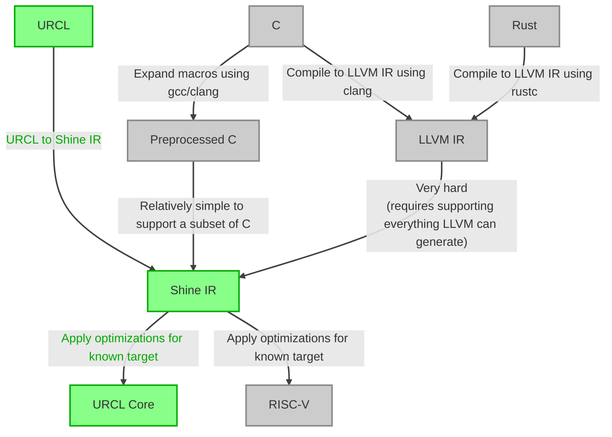

# Shine SSA compiler
Shine is an optimizing compiler with custom target architecture which aims to remain relatively simple wherever possible.
Uses custom intermediate representation (Shine IR) on which the compiler applies optimizations.

### Example architecture

